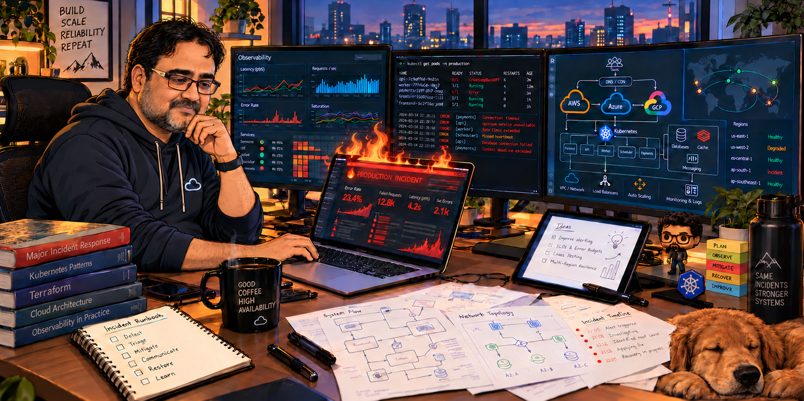

## Hi, I'm Ashish 👋

I lead cloud infrastructure and production operations for SaaS platforms. My work spans AWS, Azure , with a focus on reliability, observability, incident response and building strong engineering teams , shipping reliable updates , achive 5 9's availability and reliability and Happy customers .

### What I work on

- **Reliability:** Production availability, major incident response, root cause analysis and disaster recovery, 24/7 coverage design ,Observability and automation.
- **Cloud platforms:** Infrastructure design, cloud migrations, Kubernetes and Terraform, IaC and no click deployments.
- **Operational improvement:** Monitoring, automation, change management and cloud cost optimization.
- **Leadership:** Developing engineers and managers, building global teams and partnering across Product, Engineering and Security and value co-creation by bridging the gap bnetween product, devlopment, comliance, marketing and Operations.

### Tools and platforms

**Cloud:** AWS · Azure · GCP  
**Infrastructure and automation:** Kubernetes · Terraform · Ansible · Python · Jenkins · Git  
**Observability:** Grafana · Prometheus · CloudWatch  · ELK 

### 

### Connect

[LinkedIn](https://www.linkedin.com/in/ashisharora14/)
